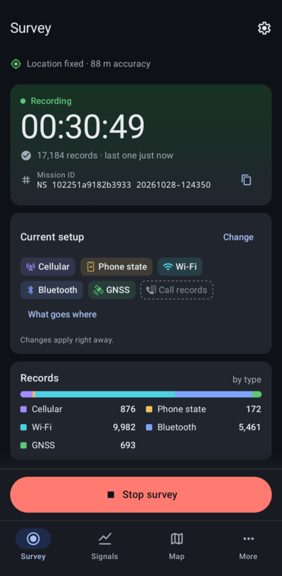
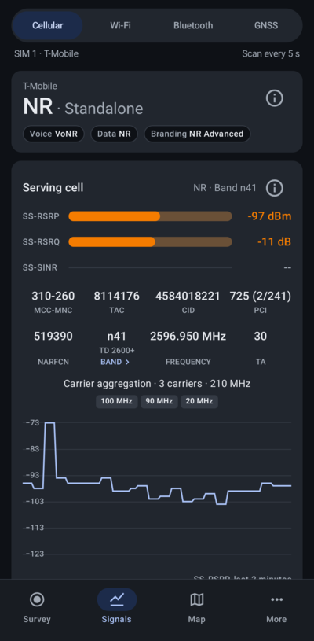
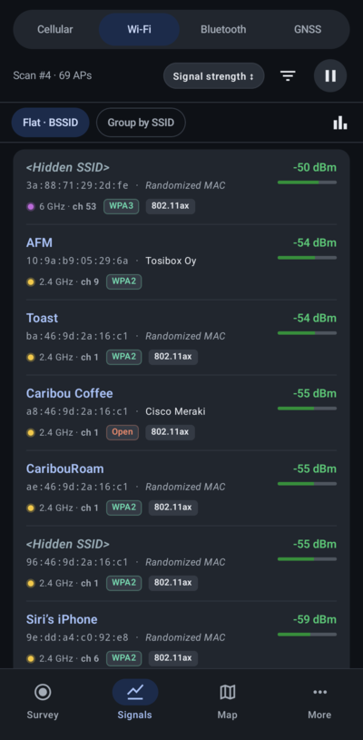
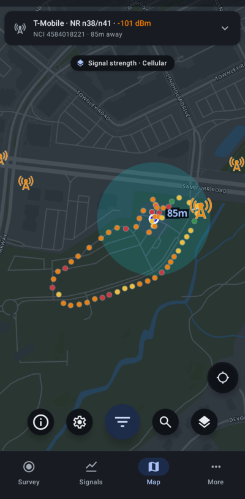

# Network Survey Android App


[](https://github.com/christianrowlands/android-network-survey/blob/develop/LICENSE)

[](https://hosted.weblate.org/engage/network-survey-android-app/)

[](https://play.google.com/store/apps/details?id=com.craxiom.networksurvey&referrer=utm_source%3Dgithub-android-readme)
[](https://apt.izzysoft.de/fdroid/index/apk/com.craxiom.networksurvey)
[](https://f-droid.org/packages/com.craxiom.networksurvey/)

The Network Survey Android App turns an Android phone into a wireless survey tool for Cellular
networks, Wi-Fi networks, Bluetooth devices, and GNSS constellations. A survey has one Start and one
Stop. On the Survey tab you pick the record types to survey (Cellular, Phone state, Wi-Fi,
Bluetooth, GNSS, and Call records) and the destinations the records go to. Several destinations can
run at once, and each one receives every record type it can carry:

* **Log files**: CSV files on the phone, one per record type. The only destination for Call records.
* **NS Analytics**: uploads to your team's [NS Analytics](https://www.networksurvey.app/analytics)
  workspace, connected by scanning a QR code.
* **MQTT stream**: JSON records to your own MQTT broker.
* **gRPC stream**: protobuf records to your own gRPC server.
* **Community databases**: cellular records to [OpenCelliD](https://opencellid.org/), and cellular
  and Wi-Fi records to [BeaconDB](https://beacondb.net/).

The Network Survey user manual can be found [here](https://networksurvey.app/manual).

<p align="center">
  
  
  
  
</p>

## Features

* **Survey tab**: choose what to survey and where it goes, see "What goes where", and start or stop
  with one button. Each survey gets its own Mission ID.
* **Saved setups**: save what to record and where it goes, and switch back to it with one tap.
* **Signals**: live Cellular, Wi-Fi, Bluetooth and GNSS views. Long press copies a value.
* **Map**: towers from OpenCelliD and BTSearch, BeaconDB coverage, and My survey points (recorded for
  surveys that send to NS Analytics or the Community databases).
* **Watchlist**: a notification when a saved Wi-Fi network (SSID or BSSID) is seen, with a history.
* **Tools**: Cellular tools (LTE and 5G NR bands, channel to band, cell ID decoders), PLMN lookup,
  OUI lookup, and Wi-Fi spectrum.
* **Themes**: light, dark or system theme and a choice of accent colors.
* **Managed configuration (MDM)**: each record type and destination can be set to "Operator
  chooses", "Always on" or "Off", along with the MQTT broker, auto start and other settings.
* **Intent API**: other apps can start and stop a survey (see [Intent API](#intent-api)).

## CDR Log Files

**Introduction:**
The Network Survey app now includes a feature for logging Call Detail Records (CDR). This
functionality provides insight into various interactions your phone has with the cellular network.

**What is a CDR?**
A Call Detail Record (CDR) is a data record that documents specific interactions a phone has with
the cellular network. These interactions include phone calls, SMS and MMS messages, and changes in
cell tower connections.

**Use Cases:**

- **Monitoring Network Activity:** Record and review your phone's cellular network interactions.
- **Educational Insight:** Gain an understanding of how cellular networks operate.
- **Privacy Monitoring:** Check if your phone is connecting to unexpected cell towers.

**Note on Feature Limitations:**

- The regular version of Network Survey does not log SMS or MMS events in the CDR due to Google
  Play's policy against apps requesting full SMS permissions.
- Logging the "other" phone number associated with call events is also not supported in the regular
  version.
- RCS chats are not logged by either version. Android only lets the default messaging app see RCS
  messages, so there is no way for Network Survey to record them.

**Alternative Version with Extended Features:**
If you're interested in CDR logging that includes SMS and MMS events and call details:

1. **Install from Source:** You can build and install the app using the source code available in
   this repository.
2. **Download Pre-Built APK:** Access the latest "*cdr-release.apk" under the latest release on
   our [GitHub Releases page](https://github.com/christianrowlands/android-network-survey/releases).
3. **IzzyOnDroid:** Install
   from [IzzyOnDroid](https://apt.izzysoft.de/fdroid/index/apk/com.craxiom.networksurvey).

## Tracking And Privacy

The version of this app on the Play Store has Firebase Crashlytics and Analytics set up. This means
that app crash logs and analytics are sent off the device to Firebase. If you don't want to
participate in this type of tracking then you have three options.

1. Install the app
   from [IzzyOnDroid](https://apt.izzysoft.de/fdroid/index/apk/com.craxiom.networksurvey).
2. Install the app from the source code in this repo specifying the CDR build variant.
3. Install the app using the CDR APK from
   the [Release Page](https://github.com/christianrowlands/android-network-survey/releases).

The [privacy policy for this app](privacy_policy.md) contains more information on the data that is
sent to Firebase for the Google Play Store version of this app.

## Getting Started

To build and install the project follow the steps below:

    1) Clone the repo.
    2) Open Android Studio, and then open the root directory of the cloned repo.
    3) Connect an Android Phone (make sure debugging is enabled on the device).
    4) Install and run the app by clicking the "Play" button in Android Studio.

If you want to build using the command line, the apk can be built and installed using the following
commands. Make sure your phone is connected to your computer before running the install command.

There are two build variants available for this app. The default build variant is the regular
version of the app which is the "Google Play" version. As noted in the privacy section, the
"Google Play" version has Firebase Crashlytics and Analytics enabled. The second build variant is
the "CDR" version. The "CDR" version does not have Firebase Crashlytics and Analytics enabled, and
it has the extended CDR logging features (as discussed above).

### Build and Install the Regular Version

> NOTE: If building on Windows, replace `./gradlew` with `gradlew`

```shell
./gradlew assembleRegularDebug
./gradlew installRegularDebug
```

### Build and Install the CDR Version

```shell
./gradlew assembleCdrDebug
./gradlew installCdrDebug
```

### Run Tests

> NOTE: This requires a connected device (physical device or Android Emulator)

```
./gradlew connectedAndroidTest
```

### Prerequisites

Install Android Studio to work on this code.

## gRPC Survey Record Streaming

The gRPC stream destination sends GSM, CDMA, UMTS, LTE, NR, 802.11, Bluetooth, GNSS, Phone State, and
Device Status records to a gRPC server. The
[Network Survey Messaging](https://github.com/christianrowlands/network-survey-messaging)
library can be used to stand up a gRPC server. From there it is up to the implementation to handle
the incoming survey messages.

If you want to see how to use the generated Go code to create a gRPC server, check out the code at
https://github.com/christianrowlands/ns-messaging-go-grpc-server

The server does not do anything useful, but serves as an example of how one might be created in
GoLang.

## MQTT Broker Survey Record Streaming

The MQTT stream destination publishes GSM, CDMA, UMTS, LTE, NR, 802.11, Bluetooth and GNSS survey
records to a connected MQTT broker on the following MQTT topics:

* gsm_message
* cdma_message
* umts_message
* lte_message
* nr_message
* 80211_beacon_message
* bluetooth_message
* gnss_message

There is also a DeviceStatus and a PhoneState message that is published on
the `device_status_message` topic.

While "Stream over MQTT" is on (under Watchlist in Settings, on by default), Wi-Fi watchlist events
are published too:

* watchlist_match_message (a watched network was seen)
* watchlist_entry_message (the phone's watched networks and their labels)

The MQTT Broker connection supports both plain text and TLS/SSL connections, and the app can save
more than one broker.

The survey messages are sent in JSON format following the protobuf definitions from
the [Network Survey Messaging](https://github.com/christianrowlands/network-survey-messaging)
library. [The API documentation is published to a web page here](https://messaging.networksurvey.app/).

### MQTT broker QR code

On the MQTT stream page, "Scan a QR code" saves a broker from a QR code that contains a JSON string
with the following fields.

The `mqtt_client` field is optional and will default to the App's auto-generated value.

The `mqtt_topic_prefix` field is used to prefix the MQTT topics that the survey records are
published to. The default topics are listed above (e.g. `lte_message`), but if you want to add a
custom prefix, you can use the `mqtt_topic_prefix` field to change the topic to something like
`my/custom/topic/lte_message` by setting the value to `"mqtt_topic_prefix": "my/custom/topic/"`
(notice the trailing slash).

```json
{
  "mqtt_host": "mqtt.example.com",
  "mqtt_port": 8883,
  "mqtt_tls": true,
  "mqtt_client": "aclient",
  "mqtt_username": "auser",
  "mqtt_password": "apassword",
  "mqtt_topic_prefix": "my/custom/topic/path/",
  "mqtt_qos": 1,
  "device_status_stream_enabled": true
}
```

What gets streamed comes from the record types selected for the survey. A QR code does not choose
record types, so the per-type flags from older versions (`cellular_stream_enabled`,
`phone_state_stream_enabled`, `wifi_stream_enabled`, `bluetooth_stream_enabled`,
`gnss_stream_enabled`) are ignored when a code is scanned.

## Intent API

The Network Survey app supports an Intent API that allows other apps to start and stop a survey. The
Intent API is documented on the [Intent API website](https://www.networksurvey.app/intent-api).

## Community Databases

The **Community databases** destination lets you voluntarily contribute collected **cellular and
Wi-Fi survey data** to public databases. It is **optional** and off unless you turn it on.

### Supported Databases:

- **[OpenCelliD](https://opencellid.org/)**: a global open cell tower database. Takes cellular
  records.
- **[BeaconDB](https://beacondb.net/)**: a crowdsourced geolocation database. Takes cellular and
  Wi-Fi records.

Records from a survey that sends to the Community databases are kept on the phone and uploaded
automatically ("Upload automatically") or when you choose "Upload now". Only cellular and Wi-Fi
records are used, and the Mission ID is not sent. No phone numbers or IMEIs are included in
uploads, but Wi-Fi uploads include each network's name (SSID) and hardware address (BSSID).

For more details, visit the
[Network Survey User Manual](https://networksurvey.app/manual/advanced/upload-databases/).

## APK Verification

To verify the authenticity of Network Survey, compare the signing certificate
SHA-256 fingerprint using `apksigner verify --print-certs <apk-file>` or apps
like AppVerifier.

### Google Play Store

Package: `com.craxiom.networksurvey`
SHA-256:
`F5:85:5E:DE:9F:51:DD:EF:D7:2B:1C:D5:A2:29:76:1A:B7:35:2B:30:AD:4F:5F:CE:6D:E2:48:73:9F:4B:4C:79`

### GitHub Releases / Direct APK

Package: `com.craxiom.networksurvey`
SHA-256:
`AB:F5:AD:29:11:FE:31:91:6F:4E:25:5C:17:33:A3:F6:BC:2C:AB:2F:28:16:C9:58:7D:E1:1A:41:58:71:AF:07`

Verification info also published at: https://networksurvey.app/manual/permissions/apk-verification/

## Translations

Network Survey is localized with the help of the community using
[Weblate](https://weblate.org/), a libre web-based continuous localization platform. If you
would like to help translate the app into your language, you can contribute directly from
your browser with no coding required at the
[Network Survey project on Weblate](https://hosted.weblate.org/engage/network-survey-android-app/).

A big thank you to everyone who has helped translate Network Survey.

## Credits and Acknowledgements

### Credits

This project uses elements from the **[GPSTest Android app](https://github.com/barbeau/gpstest)**,
specifically the GPS user interface components. We appreciate the GPSTest app for making these
resources available and acknowledge their contribution to the open source community.

This project also leveraged the code from *
*[Tower Collector](https://github.com/zamojski/TowerCollector)**
for the upload of survey records to OpenCellID and BeaconDB. We appreciate the Tower Collector app.

### Acknowledgements

We would like to express our gratitude to all the contributors who have dedicated their time and
skills to this project. Your contributions have been invaluable to the development and success of
this application.

Thank you to:

<a href="https://github.com/christianrowlands/android-network-survey/graphs/contributors">
  
</a>

Made with [contrib.rocks](https://contrib.rocks).

Your commitment and hard work are sincerely appreciated.

## Changelog

See the change log for details about each release: [`CHANGELOG.md`](CHANGELOG.md)

## Contact

* **Christian Rowlands** - [Craxiom](https://github.com/christianrowlands)
